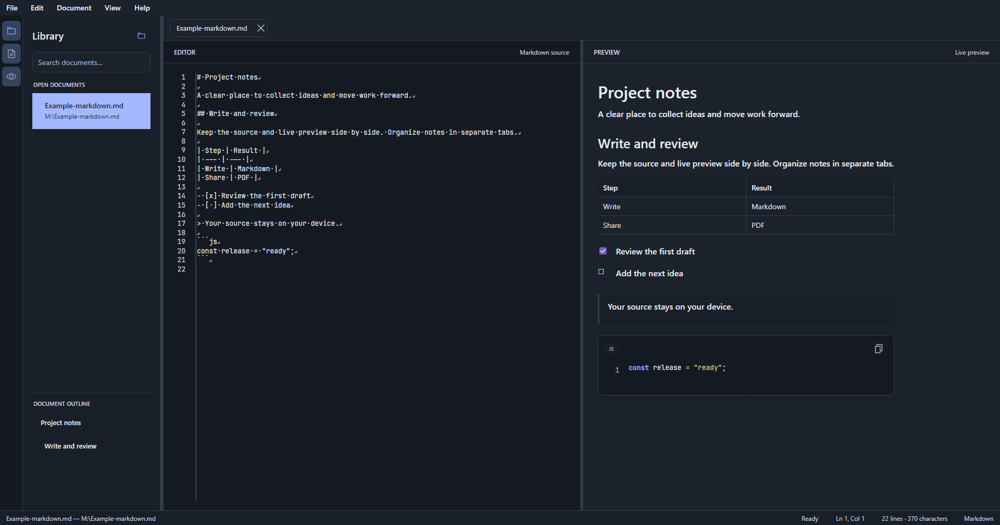

# markdim

**A free, open-source desktop Markdown workspace for reading, writing, organizing, and exporting documents—with live preview and local PDF export.**

[](https://github.com/numera11y/markdim/actions/workflows/ci.yml)
[](https://github.com/numera11y/markdim/releases/latest)
[](LICENSE)
[](https://github.com/numera11y/markdim/releases/latest)

The current version is **0.3.0-beta.7**. This public beta provides Windows x64 and Linux x64/ARM64 downloads. The version is shown in **Help → About** and is defined in `Directory.Build.props`.



## Why markdim?

markdim keeps the Markdown source and its rendered result side by side. Open one file or a folder of notes, switch between documents in reorderable tabs, and export a local PDF without leaving the desktop app.

### Features

- **Live Markdown preview** powered by Markdig: CommonMark and advanced GFM extensions, including nested lists, tables, task lists, reference links, local images, and HTTPS remote images.
- **Multi-document workspace** with tabs, drag-and-drop opening, recent files, document search, and a heading outline.
- **Search and replace** in the current document, with next/previous navigation.
- **Local PDF export** with embedded IBM Plex Sans for text and JetBrains Mono for code.
- **A configurable workspace**: light/dark themes, resizable panels, adjustable editor text size, visible whitespace and line endings, and persisted layout preferences.
- **English and French UI**, following the system language by default and falling back to English.
- **Local-first document handling**: files stay at their existing locations; there is no account, cloud sync, advertising, or telemetry.

The source editor intentionally remains plain text (without syntax highlighting) so Markdown characters are easy to inspect. Whitespace and line-ending markers are enabled by default and can be changed independently.

## Download and install

Download the latest beta from [GitHub Releases](https://github.com/numera11y/markdim/releases/latest).

| Platform | Available packages | Notes |
|---|---|---|
| Windows x64 | Setup `.exe`, portable `.zip` | Windows 10 version 2004 (build 19041) or later, or Windows 11. The beta installer is unsigned, so Windows may show a SmartScreen warning. |
| Debian/Ubuntu x64 | `.deb` package, portable `.tar.gz` | Install a downloaded package with `sudo apt install ./markdim-v0.3.0-beta.7-linux-amd64.deb`. |
| Debian/Ubuntu ARM64 | `.deb` package, portable `.tar.gz` | Use the ARM64 assets on the Releases page. |
| Other Linux distributions | Portable `.tar.gz` for x64 or ARM64 | Required system graphics libraries depend on the distribution. |
| macOS | No public beta package yet | macOS x64 and ARM64 are configured as stable-release build targets; signing and notarization are still required for public distribution. |

Installable packages add application shortcuts and register Markdown file associations where supported. On Windows, markdim can be added to **Open with** from **Settings → Markdown file association**; choosing the system default app remains an action in Windows Settings.

## Getting started

1. Open a `.md` or `.markdown` file, open a folder, or drag Markdown files onto the app.
2. Edit the source in the editor and review the rendered result in the preview pane.
3. Use the library, search field, heading outline, and tabs to navigate your notes.
4. Choose **File → Export PDF** to create a PDF on your device.

### Keyboard shortcuts

| Shortcut | Action |
|---|---|
| `Ctrl+O` / `Ctrl+Shift+O` | Open file / open folder |
| `Ctrl+N` | Create a blank document |
| `Ctrl+S` / `Ctrl+Shift+S` | Save / Save as |
| `Ctrl+W` | Close the active tab |
| `Ctrl+Shift+E` | Export to PDF |
| `Ctrl+F` / `Ctrl+H` | Find / find and replace in the document |
| `Ctrl+Tab` / `Ctrl+Shift+Tab` | Next / previous document |
| `Ctrl+Shift+Page Up` / `Ctrl+Shift+Page Down` | Reorder the active tab |
| `Ctrl+K` / `Ctrl+E` | Focus library search / editor |
| `F11` | Toggle full screen |
| `Ctrl` + mouse wheel | Increase or decrease editor text size |

The complete list is available under **Help → Keyboard Shortcuts**.

## Files, settings, and privacy

Markdown files are read and saved locally. Application settings and diagnostic logs are stored under the current user profile:

- Windows: `%LOCALAPPDATA%\markdim\settings.json` and `%LOCALAPPDATA%\markdim\logs\application.log`
- macOS: `~/Library/Application Support/markdim/`
- Linux: `~/.local/share/markdim/`

The preview can load remote images referenced by a Markdown document over HTTPS. In that case, markdim requests the image from its host to display it; the document itself is not uploaded. External links open through the operating system.

For optional UI diagnostics, launch `markdim.exe --debug file.md` and press `Ctrl+Shift+F12` to save a screenshot. Diagnostic screenshots may contain the document currently displayed; review them before sharing. Logs record app operations and exception types, not document text or paths.

## Build and test

Requirements: .NET 10 SDK (the repository's `global.json` selects a compatible SDK).

```sh
dotnet restore markdim.slnx --locked-mode
dotnet run --project MarkdownDesk/MarkdownDesk.csproj
dotnet test markdim.slnx -c Release
```

For the full formatting, build, test, and dependency-audit checks, see [docs/TESTING.md](docs/TESTING.md). Contribution and translation instructions are in [CONTRIBUTING.md](CONTRIBUTING.md).

## Version and releases

`Directory.Build.props` is the single source for the app's semantic version. GitHub Actions publishes Windows and Linux packages for beta tags (`vX.Y.Z-beta.N`); stable tags (`vX.Y.Z`) build Windows, macOS, and Linux targets. Release archives, installers, and Debian packages include SHA-256 checksums. See [docs/RELEASE_LAYOUT.md](docs/RELEASE_LAYOUT.md) for package details.

The separate Microsoft Store MSIX package is built with `packaging/windows/Build-StorePackage.ps1`; its four-part package version is distinct from the app's semantic version. Microsoft signs the submitted MSIX package.

## License

markdim is distributed under the [MIT License](LICENSE). PDF fonts are distributed under the SIL Open Font License 1.1; their notices are included in the release files. See [docs/DEPENDENCIES.md](docs/DEPENDENCIES.md) for third-party dependency licenses.
